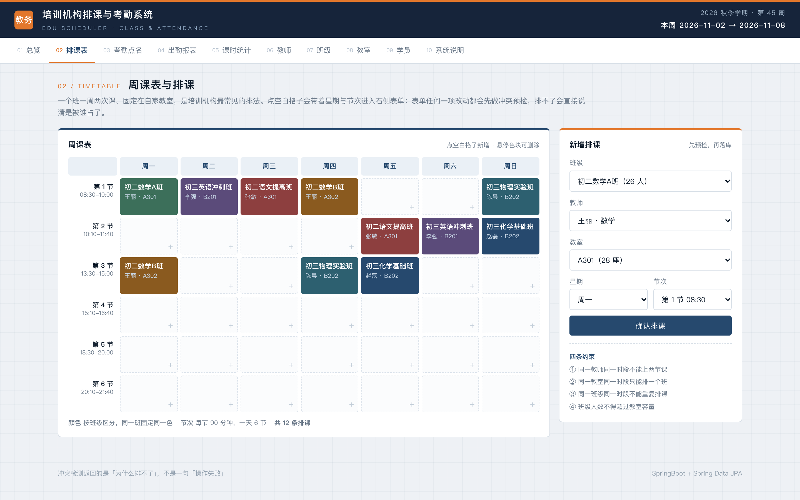
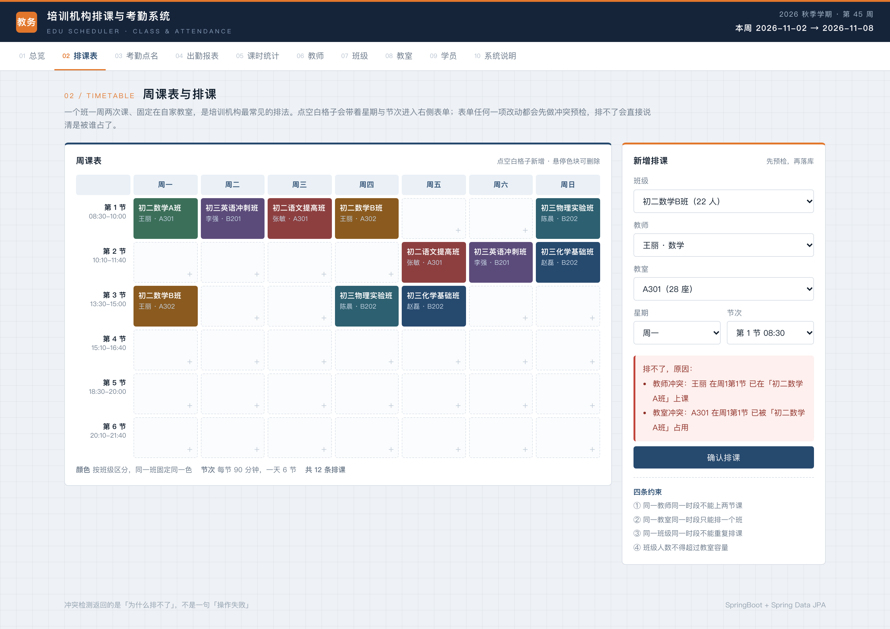
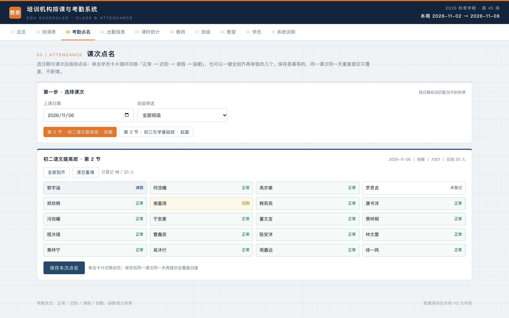
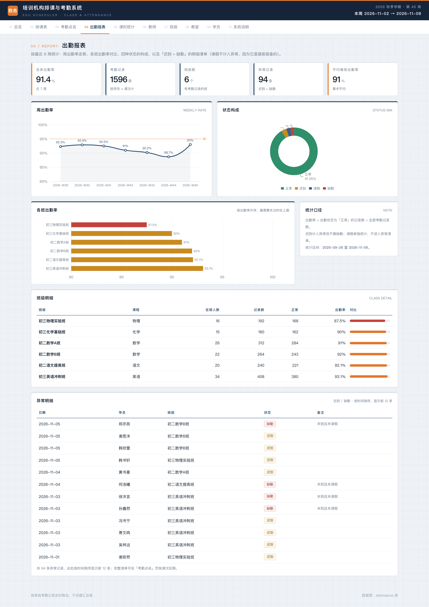
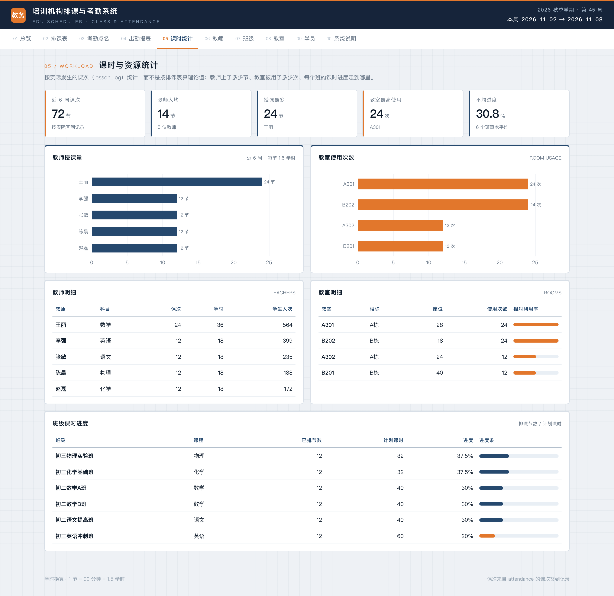
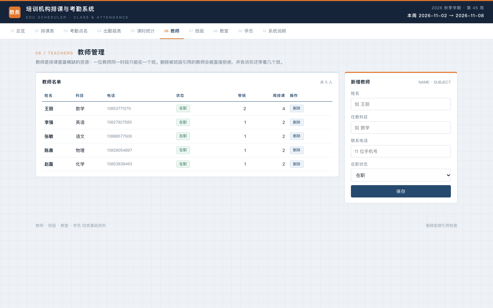
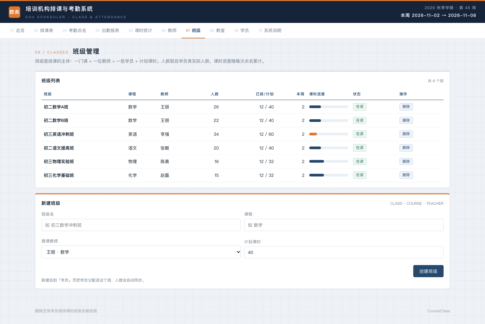
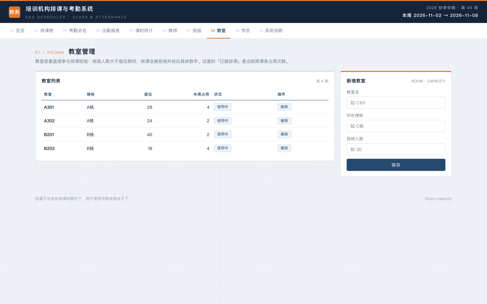
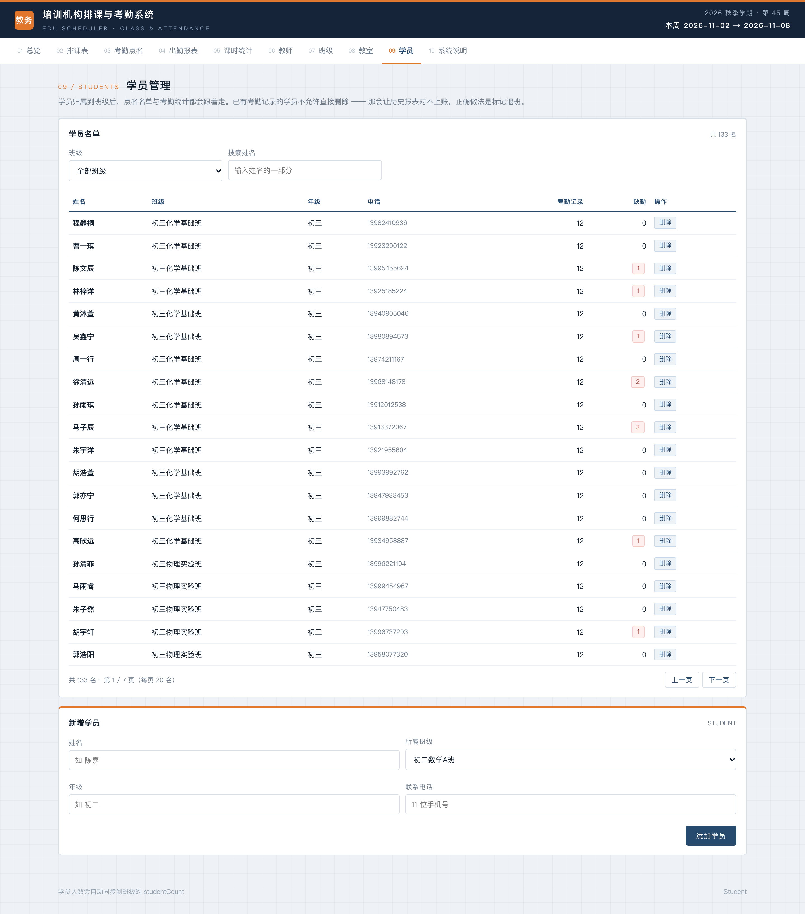

# 023 基于 SpringBoot 的培训机构排课与考勤系统-设计展示

> **代码有偿获取 可接受定制 微信联系方式: csbysj2020 或 ACE2487，备注(BS)**

> **完整源码与全套文档 · 在线自助获取 >>> [https://mbd.pub/o/bread/YZaWlZhvaw==](https://mbd.pub/o/bread/YZaWlZhvaw==)**

> **成品页（功能介绍 / 更多选题）>>> [https://bishe.suilang.net/products/edu-schedule](https://bishe.suilang.net/products/edu-schedule)**

> 

> 

## 视频

> **点击查看 >>> [https://www.bilibili.com/video/BV1Ez4i6iEb1/](https://www.bilibili.com/video/BV1Ez4i6iEb1/)**

## 项目简介

培训机构排课受四条硬约束同时限制：同一教师同一时段只能上一节课、同一教室同一时段只能排一个班、同一班级同一时段不能重复排课、班级人数不得超过教室容量。人工排课的代价不在算不出来，而在核对成本。

本系统把四条规则写成可解释的冲突清单——排不了时返回「教师冲突：王丽 在周1第1节 已在『初二数学A班』上课」这类具体原因，而不是一句「操作失败」。同时实现周课表网格、课次点名、出勤报表、课时统计与四类基础资料维护。

数据说明：机构真实排课与学员信息属私有资料，公开渠道没有可用数据集，因此演示数据由程序按固定随机种子生成，页面、论文与使用说明三处均如实标注。

本仓库为**设计展示**：包含项目说明、技术架构、实验结果与运行截图；完整源码、任务书、开题报告、毕业论文与使用说明可通过上方链接自助获取，成品页可查看更多选题，也可联系微信咨询定制。

## 功能特性

1. 可解释的冲突检测：四条规则分别实现，命中时生成带名称的描述（如「教师冲突：王丽 在周1第1节 已在「初二数学A班」上课」），一次返回全部原因而不是一句「操作失败」

2. 两级校验：/api/schedule/check 只校验不落库（表单改动即预检），POST /api/schedule 写入前复检，防止绕过界面直接调接口写冲突数据

3. 周课表网格：7 天 × 6 节用 CSS Grid 绘制，点空白格带入星期与节次发起排课，悬停色块可删除，选班级自动带出该班教师

4. 点名幂等：对「课次 + 日期 + 学员」覆盖写，重复提交不产生脏数据；未登记状态不默认成「正常」，避免漏点被算成到课

5. 引用检查式删除：删被班级引用的教师、删还有学员或排课的班级、删已有考勤记录的学员，都会被拒绝并说明还被谁引用

6. 出勤数据分析：6 周 1596 条记录，总体出勤率 91.4%（迟到 3.51% / 请假 2.76% / 缺勤 2.38%）；迟到多于缺勤，说明管理重心在到课时间

7. 资源利用率：A301 与 B202 周使用 24 次满负荷、A302 与 B201 仅 12 次，暴露「一个班固定一间教室」策略下的容量错配

8. 10 个页面：总览 / 排课表 / 考勤点名 / 出勤报表 / 课时统计 / 教师 / 班级 / 教室 / 学员 / 系统说明，ECharts 本地内置离线可用

## 技术架构

| 项目 | 说明 |
| --- | --- |
| 编程语言 | Java 17 |
| 后端框架 | SpringBoot 3.2.5、Spring Data JPA、Bean Validation |
| 数据库 | MySQL 8.0（交付默认 H2 文件库，免安装、可切换） |
| 前端 | 原生 HTML + CSS + JavaScript（随 jar 发布，无构建步骤） |
| 可视化 | ECharts 5（已内置本地文件，离线可用） |
| 数据规模 | 7 张表 / 12 个接口 / 10 个页面；演示数据 6 班 133 名学员 1596 条考勤 |
| 操作系统 | Windows / macOS / Linux |
| 启动方式 | 双击一键脚本，或 java -jar edu-schedule.jar --server.port=8089 |

## 目录结构

以下为完整交付版的结构（本仓库仅作设计展示）：

```
edu-schedule/
├── 任务书/
│   └── 毕业设计任务书.docx
├── 开题报告/
│   └── 毕业设计开题报告.docx
├── 最终论文/
│   ├── 图/
│   │   ├── 图3-1_系统用例图.png
│   │   ├── 图4-1_系统架构图.png
│   │   ├── 图4-2_功能模块图.png
│   │   ├── 图4-3_排课与冲突检测流程图.png
│   │   └── 图4-4_数据库ER图.png
│   └── 基于SpringBoot的培训机构排课与考勤系统设计.docx
├── 源码/
│   ├── .mvn/
│   │   └── wrapper/
│   ├── data/
│   │   └── edu.mv.db
│   ├── src/
│   │   └── main/
│   ├── edu-schedule.jar
│   ├── mvnw
│   ├── pom.xml
│   ├── README.md
│   ├── settings.xml
│   ├── 启动系统.bat
│   └── 启动系统.command
├── 演示截图/
│   ├── 023-01-overview.png
│   ├── 023-02-schedule.png
│   ├── 023-03-conflict.png
│   ├── 023-04-attendance.png
│   ├── 023-05-report.png
│   ├── 023-06-workload.png
│   ├── 023-07-teachers.png
│   ├── 023-08-classes.png
│   ├── 023-09-rooms.png
│   └── 023-10-students.png
├── 功能演示.mp4
├── 封面.jpg
├── 系统使用与二次开发说明.docx
├── 系统使用与二次开发说明.md
└── 遇到问题.txt
```

## 数据规模与实验结论

| 指标 | 结果 |
| --- | --- |
| 演示数据 | 5 教师 / 4 教室 / 6 班 / 133 学员 / 12 条周排课 / 72 课次 / 1596 条考勤 |
| 总体出勤率 | 91.4%（正常 91.35%、迟到 3.51%、请假 2.76%、缺勤 2.38%） |
| 周出勤率 | 92.9% → 88.7% → 93.0%（末周仅 201 条记录，样本不足） |
| 教室使用 | A301 与 B202 各 24 次（满负荷），A302 与 B201 各 12 次 |
| 班级课时进度 | 20% ~ 37.5% |

两个反直觉的结果：一是**迟到（56 条）多于缺勤（38 条）**，管理重心应放在到课时间；二是课时进度差异的根源不在教师，而在「计划课时 ÷ 每周节数」超过学期长度——英语冲刺班 60 课时、每周 2 节需 30 周，这提示排课系统还应做节奏校验（论文 6.4 节）。

## 交付内容

1. 完整源码（7 张实体表 + 3 个控制器 + 冲突检测服务 + 演示数据生成器）
2. 已灌好演示数据的 H2 库与可执行 jar（免安装、免联网构建）
3. 毕业设计任务书（Word）
4. 毕业设计开题报告（Word）
5. 毕业论文（Word，七章制，含冲突检测设计、出勤数据分析与系统边界说明）
6. 系统使用与二次开发说明（Word + md）
7. 系统运行截图 10 张 + 功能演示视频

## 常见问题

**数据是真实的机构数据吗？**

不是。培训机构的排课与学员信息属于机构私有资料，公开渠道没有可用数据集，因此教师、班级、学员、出勤记录全部由程序按固定随机种子生成（5 位教师 / 4 间教室 / 6 个班 / 133 名学员 / 12 条周排课 / 72 个课次 / 1596 条考勤）。固定种子是为了让论文里的每个数字都能复现——删掉 data 目录重启，得到的仍是同一组数据。页面与论文都标注了这一点。

**那论文里的结论还有意义吗？**

有意义，但要看清它说明的是什么：出勤率、迟到多于缺勤、课时进度差异，反映的是统计口径与数据生成规则；换成真实数据后，系统算的是同一套口径。这一点写在论文 6.1 与 6.5 节。

**冲突检测到底怎么做的？**

对一条待排记录，依次检查：同教师同（星期,节次）是否已有课、同教室同（星期,节次）是否被占、该班同（星期,节次）是否重复、班级人数是否超过教室容量。四条规则分别实现，返回 List<String> 而不是 boolean，因为四条可能同时命中，全部列出才有用。实现位置在 ScheduleService.conflicts()。

**为什么不返回一个「成功/失败」就够了？**

因为使用者需要知道「为什么排不了」。只回失败，教务只能反复试错；回「教师王丽 在周1第1节 已在初二数学A班上课」，他就能直接决定改教师还是改节次。这是本项目最主要的设计取向。

**考勤重复提交会不会产生重复记录？**

不会。保存时对「课次 + 日期 + 学员」做覆盖写，同一课次同一天重复提交只更新状态，并同步课次的实到/缺勤人数。

**为什么「未登记」不默认成「正常」？**

默认正常会让漏点的人被统计成到课，这是考勤系统最常见的失真来源。系统把未登记单独显示，报表只统计明确登记过的记录。

## 截图











